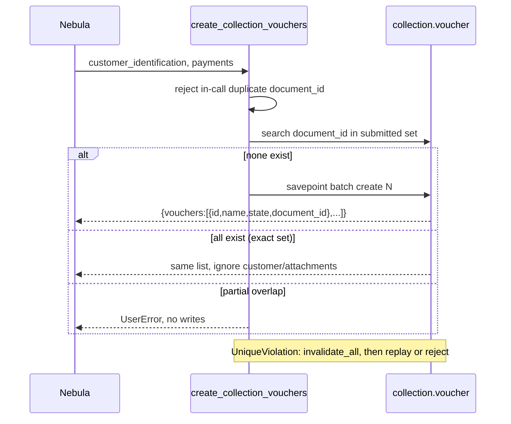

# Design: Standalone Payment Vouchers

## Technical Approach

Drop `collection.voucher.line`. Flatten payment, attachment, review audit, and
`pending|approved|rejected` onto `collection.voucher`. One Payment Vouchers surface. MCP
`create_collection_vouchers` creates N vouchers in one savepoint. Coordinated Nebula
rename + list formatter. Reset/reinstall — no conversion.

## Architecture Decisions

| Decision | Options                                | Tradeoff                            | Choice                            |
| -------- | -------------------------------------- | ----------------------------------- | --------------------------------- |
| Model    | Flatten vs header+line vs batch parent | Blast vs dual state                 | Flatten; drop line                |
| Data     | Reset vs SQL/chatter conversion        | History lost vs `res_model` rewrite | Reset; no migrate script          |
| Kanban   | `write()` gate vs no-drag vs JS        | Drag must equal buttons             | Intercept `state`                 |
| Review   | Queue on voucher vs line RPCs          | OWL already uses `LINE_MODEL`       | Move RPCs to voucher              |
| MCP      | Rename vs dual names                   | Dual hides deploy skew              | `create_collection_vouchers` only |
| Replay   | Exact set = all vouchers vs one parent | Cross-voucher was an error          | Exact set = success list          |
| Apply    | Collection-only vs nebula-agent grant  | Else `edit_authority_missing`       | Config + grant                    |

Rejected: UI-only flatten, grouping header, conversion.

## Data Flow

Create → voucher. Kanban/button `state` → `write()` → approve/reject (reviewer/time).
OWL review RPCs refuse when flag OFF; buttons work.



## File Changes

### collection

| File                                                         | Action | Description                                                                       |
| ------------------------------------------------------------ | ------ | --------------------------------------------------------------------------------- |
| `models/collection_voucher.py`                               | Modify | Flatten fields; `write()` gate; review RPCs; `@api.ondelete`; `models.Constraint` |
| `models/collection_voucher_line.py`                          | Delete | Drop model                                                                        |
| `models/__init__.py`                                         | Modify | Drop line import                                                                  |
| `tools/collection_voucher.py`                                | Modify | Rename MCP; voucher create; list response; no `sudo()`                            |
| `views/collection_views.xml`                                 | Modify | Flatten form; drop Payment Lines XML IDs; `<list>`; `t-name="card"`               |
| `static/src/document_review/*`                               | Modify | `LINE_MODEL="collection.voucher"`; `/web/content`                                 |
| `security/ir.model.access.csv`                               | Modify | Drop line ACL                                                                     |
| `data/ir_sequence_data.xml`                                  | Modify | Keep `seq_collection_voucher` / `collection.voucher`                              |
| `__manifest__.py`                                            | Modify | `19.0.1.8.0` → `19.0.1.9.0`                                                       |
| `tests/test_collection_*.py`                                 | Modify | Retarget voucher; MCP list replay                                                 |
| `AGENTS.md`, `readme/DESCRIPTION.md`, `openspec/config.yaml` | Modify | Standalone model; nebula-agent root                                               |
| `views/collection_document_review_views.xml`                 | Modify | Keep client action/menu IDs                                                       |

Unchanged: flag/menu hide. Keep `migrations/19.0.1.7.0/`. Ignore leftover
`document-review-feature-flag`.

### nebula-agent

| File                                                                  | Action | Description                                                                         |
| --------------------------------------------------------------------- | ------ | ----------------------------------------------------------------------------------- |
| `src/agent/tools/collection_voucher.py`                               | Modify | `MCP_TOOL_NAME="create_collection_vouchers"`; list formatter; keep first-party name |
| `tests/unit_tests/test_collection_voucher.py`                         | Modify | Name + list identity/replay                                                         |
| `tests/integration_tests/test_graph.py`                               | Modify | MCP name patches                                                                    |
| `openspec/specs/collection-voucher-registration/spec.md`, `AGENTS.md` | Modify | One voucher per payment; exact MCP name                                             |

## Interfaces / Contracts

MCP `@mcp_tool(name="create_collection_vouchers", category="write", registry="mcp")` on
`muk_mcp.mixin`. Request: `(customer_identification, payments)`; each payment needs
`document_id` + `document_type`; optional `attachment {name, mimetype, datas}`.

Response (create and exact replay, payment order):

```python
{"vouchers": [{"id": int, "name": str, "state": str, "document_id": str}, ...]}
```

Atomicity: `with env.cr.savepoint(): Voucher.create([{...}, ...])`. In-call dup and
partial overlap → `UserError`, no writes. Exact set → return all vouchers; ignore
customer/attachments (former cross-voucher error). `UniqueViolation`:
`invalidate_all()`, replay or reject. Never `sudo()`.

`write()`: `state` in `{approved, rejected}` without `collection_audited_state` →
`action_approve`/`action_reject` (sets reviewer/time). `state=pending` only if
`attachment` in vals (reset); else refuse reopen. Actions `write` with the flag.
Terminal states immutable.

Review: `pending` + stored attachment; `FOR UPDATE` on `collection_voucher`;
`/web/content?model=collection.voucher&id=&field=attachment`. RPCs refuse when flag OFF;
form/kanban Approve/Reject work. Payload: `voucher_name=self.name`,
`voucher_id=self.id`.

### View / XML-ID strategy

Reuse: `view_collection_voucher_{list,search,kanban,form}`, `action_collection_voucher`,
`menu_collection_{root,voucher}`, `seq_collection_voucher`,
`action_collection_document_review`, `menu_collection_document_review`. Delete:
`view_collection_voucher_line_{list,search}`, `action_collection_voucher_line`,
`menu_collection_voucher_line`. Form: typed `invisible=`; show `unsupported`. Search:
pending/approved/rejected. Kanban: `records_draggable`, `default_group_by="state"`,
`t-name="card"`.

## Testing Strategy

| Layer       | What                                                                                      | Approach                                      |
| ----------- | ----------------------------------------------------------------------------------------- | --------------------------------------------- |
| Odoo unit   | Sequence, unlink, audited `write()`, UNIQUE, review/flag, MCP create/replay/conflicts/ACL | `tests/test_collection_*.py`                  |
| Nebula unit | MCP name, list formatter, fail-closed                                                     | `tests/unit_tests/test_collection_voucher.py` |
| Integration | Graph MCP name                                                                            | `tests/integration_tests/test_graph.py`       |
| E2E         | —                                                                                         | None                                          |

## Threat Matrix

N/A — no routing, shell, subprocess, VCS/PR, executable classification, or
process-integration boundary. MCP is a renamed method tool; OWL keeps `/web/content`.

## Migration / Rollout

Bump `19.0.1.9.0`. No conversion script. Must `invoke resetdb -m collection` (or
uninstall/reinstall); in-place `-u` unsupported. Sequence code reused; reset renumbers.
Deploy Odoo+Nebula together; restart MCP cache. `openspec/config.yaml`: widen context;
apply `roots` + guidelines include `/home/crisd/projects/nebula/nebula-agent`; apply
still needs `gentle-ai sdd-attempt grant` for both roots.

Rollback: revert both repos; restore `create_collection_voucher`; restore dump.

## Open Questions

None.
