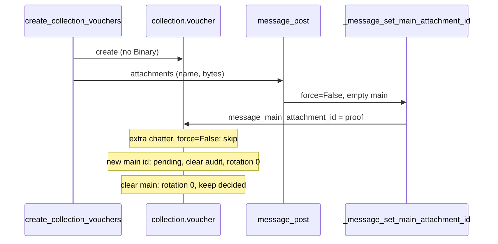

# Design: Chatter Voucher Attachments

## Technical Approach

Drop Binary `attachment` / `attachment_filename`. Inherit
`mail.thread.main.attachment` (it already includes `mail.thread`). Proof =
`message_main_attachment_id`. MCP nest `{name, mimetype, datas}` unchanged:
validate, then `message_post(attachments=[(name, bytes)])` after `create` in
the existing savepoint. Review URL `/web/content/{id}`. Keep
`attachment_rotation`. Manifest `19.0.1.12.0` → `19.0.1.13.0`. Specs were
absent at design time; this follows the proposal only.

## Architecture Decisions

| Decision | Options | Tradeoff | Choice |
| --- | --- | --- | --- |
| Proof pointer | mixin main / custom M2O / oldest-latest | native vs duplicate vs extras steal | **A** `message_main_attachment_id` |
| Inherit | replace `mail.thread` / stack both | mixin already includes thread | `["mail.thread.main.attachment", "mail.activity.mixin"]` |
| Picker | default non-xml / image+PDF | default can promote xlsx | Override `_message_set_main_attachment_id` to `image/*` + PDF |
| Extras | `force=False` / steal latest | steal resets review | Chatter `_post_add_create` is `force=False`; extras never write main |
| MCP persist | post-after-create / keep Binary | field is dropped | Post in same savepoint; exact-retry ignores nests |
| Review URL | `/web/content/{id}` / `field=attachment` | field URL dies | `/web/content/{attachment_id}` (`ir.attachment`) |
| Rotation | voucher Integer / file meta | viewer state, not bytes | Keep field+CHECK; reset 0 on main change or clear |
| Replace vs clear | new main id / empty | matches today’s Binary vs empty write | New truthy main → pending, clear audit, rotation 0. Clear → rotation 0, **do not** reopen. Kanban `state=pending` still needs a replace in the same write |
| `datas` in-place | hook / skip | id unchanged skips reset | Residual; no hook |

## Data Flow

**MCP create:** parse payments → validate nest → savepoint:
`Voucher.create` (no Binary) → if nest, `message_post` notification with
`(name, bytes)` → `res_field` empty + `mail.message` → empty main becomes
this file → `{vouchers:[{id,name,state,document_id}]}`. Exact-retry /
UniqueViolation replay: no post, no compare.

**Review:** queue `pending` AND `message_main_attachment_id`. Payload
`attachment_url=/web/content/{id}`, name/mimetype from `ir.attachment`. OWL
keeps `current.attachment_url` (no base64).

**Migration 19.0.1.13.0:** `pre-*` runs before new Python (Binary still in
registry). **pre:** rows `res_model=collection.voucher`,
`res_field=attachment`: rename from `attachment_filename` (fallback
`proof.bin`), null `res_field`, keep `res_model`/`res_id`, link
`mail.message`. **post:** set `message_main_attachment_id`; SQL net for
leftover `res_field=attachment`. Then ORM drops Binary + filename.

## Sequence: MCP attach + proof replace



## File Changes

| File | Action | Description |
| --- | --- | --- |
| `models/collection_voucher.py` | Modify | Mixin; drop Binary/filename; MIME picker; write-reset on main; queue/URL |
| `tools/collection_voucher.py` | Modify | Nest sidecar; `message_post` in savepoint; replay unchanged |
| `views/collection_views.xml` | Modify | Remove Binary widgets; `<chatter open_attachments="True"/>` |
| `static/src/document_review/*` | Modify | Payload URL/mimetype if needed; OWL already binds `attachment_url` |
| `migrations/19.0.1.13.0/pre-migrate.py` | Create | Convert field attachments before drop |
| `migrations/19.0.1.13.0/post-migrate.py` | Create | Assign main ids |
| `__manifest__.py` | Modify | `19.0.1.13.0` |
| `tests/test_collection_{mcp_tool,document_review,ui,voucher,mail,acl,document_review_flag}.py` | Modify | Chatter proof, `/web/content/{id}`, invert widgets, helpers via `message_post` |
| `AGENTS.md`, `readme/` | Modify | Apply-phase Binary wording |

No ACL XML. No Nebula. Do not touch `auto-assign-open-sheet`.

## Interfaces / Contracts

```python
voucher.message_post(
    body="Payment proof attached.",
    message_type="notification",
    attachments=[(name, raw_bytes)],
)
# payload: attachment_url=/web/content/{att.id}, filename, mimetype, rotation
```

## Testing Strategy

`invoke test -m collection` (strict TDD). No E2E.

| Layer | What | Approach |
| --- | --- | --- |
| Unit | Mixin, drop Binary, picker, replace/extra/clear, kanban reopen | `test_collection_voucher.py`, `test_collection_mail.py` |
| MCP | One chatter proof+main; omit; MIME/b64 fail-closed; exact-retry ignore | `TestCollectionMcpAttachment` |
| Review | Queue on main; `/web/content/{id}` (no `field=`); extras skip rotation reset | `test_collection_document_review.py` |
| UI/ACL/flag | No Binary widgets; chatter; helpers post-not-Binary | `test_collection_ui.py`, `acl`, `document_review_flag` |
| Migration | `res_field=attachment` → chatter + main | SQL-setup helper test or upgrade smoke |

## Threat Matrix

N/A — no routing, shell, subprocess, VCS/PR, executable-file, or
process-integration boundary. `/web/content/{id}` is existing Odoo serving.

## Migration / Rollout

`-u collection` so pre runs before field drop. Slices
(`delivery_strategy=auto-chain`, `chain_strategy=stacked-to-main`): (1)
migrate+model, (2) MCP+tests, (3) views+review. High vs 400-line budget.

**Rollback:** revert to `19.0.1.12.0` and restore Binary fields/widgets.
Keep migrated chatter `ir.attachment` / `mail.message`; do not delete proofs.

## Open Questions

- [x] None blocking. In-place `datas` write on the current main is an
  accepted residual (chatter UI add/deletes).
