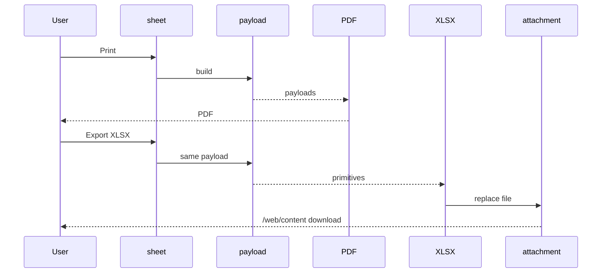

# Design: Collection Sheet Report

## Technical Approach

Shared `_collection_report_data()` on a second `_inherit = "collection.sheet"` feeds PDF
and XLSX. Bound `qweb-pdf` (`web.external_layout`, `t-out`). Header `action_print_xlsx`
→ xlsxwriter + `act_url` `/web/content`. `draft`/`confirmed`. Plan wins except stale
1.27/1.28 (disk `19.0.1.29.0`).

## Architecture Decisions

| Option                                          | Tradeoff                    | Decision                                                                |
| ----------------------------------------------- | --------------------------- | ----------------------------------------------------------------------- |
| Shared payload vs dual builders                 | Dict vs drift               | `_collection_report_data()` primitives; `sheet`/`currency` QWeb-only    |
| Second inherit vs `collection_sheet.py`         | Extra file vs collision     | `models/collection_sheet_report.py`; `write` → `super()`                |
| Inherit xpath vs allocation views               | Extra XML vs sibling        | Inject `document_kind` before `invoice_number`                          |
| QWeb + xlsxwriter vs OCA `report_xlsx`          | Two writers vs Odoo 17 JS   | QWeb + xlsxwriter 3.1.9; no custom `xlsx` type                          |
| Header button vs controller                     | Chatter Files vs HTTP       | Button + attachment; controller later drop-in                           |
| `_init_column` vs `migrations/`                 | Backfill vs migrate         | No `migrations/`; kind default `invoice`, required                      |
| Sheet % vs seller binding                       | Decouple vs live CHECK      | Sheet 0–100 `models.Constraint`; not from binding                       |
| Print drafts vs confirmed-only                  | Working copy vs under-print | All allocations/vouchers (matches `_compute_totals`)                    |
| Dual Total Cobrado                              | Silent vs warn              | `mismatch` if Σ `total_vouchers` ≠ Σ voucher amounts                    |
| Cached formulas vs literals                     | Live Excel vs `None`        | `write_formula(..., cached_value)`                                      |
| Python banner vs CF                             | Assertable vs template      | Banner from `recon.status`                                              |
| 0–100 vs Excel `0.0%`                           | Scale                       | XLSX writes `percent / 100.0`                                           |
| Catalog `code` vs Selection                     | Search vs omitted labels    | `collection.document.type` by `code`; transfer/check/deposit then alpha |
| Raw connector vs `_collection_active_connector` | Blank codes vs UserError    | Batched bindings; skip the raiser                                       |
| Mixed currencies                                | Fail vs lie                 | `UserError`                                                             |
| Manifest now vs last PR                         | XMLID wait vs conflict      | D: `web`, `data`, `19.0.1.30.0`                                         |

Odoo 19: `models.Constraint`; `@api.private`; `t-out`; related non-stored `currency_id`.

### Collision handling

Never edit claimed sheet/allocation/UI files or sibling folders. Until D skip
`__manifest__.py`, `AGENTS.md`, migration test. Unclaimed `collection_views.xml`: XLSX
last before `state`; recon second inner group. D registers `data`.

## Data Flow

```
sheet → _ensure_saved_sheet + mixed-currency UserError
     → _collection_report_data()
        ├─ QWeb _get_report_values → payloads[] → HTML (suite) / PDF (shell)
        └─ _render_xlsx → ir.attachment → act_url /web/content
```



## File Changes

| File                                                                                                                                                                              | Action | Description                                                                    |
| --------------------------------------------------------------------------------------------------------------------------------------------------------------------------------- | ------ | ------------------------------------------------------------------------------ |
| `models/collection_sheet_report.py`                                                                                                                                               | Create | Inherit: currency, %, cash, withheld, Constraint, freeze, payload, XLSX action |
| `models/collection_allocation_line.py`                                                                                                                                            | Modify | `document_kind` `invoice`/`quotation`                                          |
| `report/__init__.py`, `report/collection_sheet_report_render.py`, `report/collection_sheet_xlsx.py`                                                                               | Create | Package, QWeb values, xlsxwriter                                               |
| `report/report_paperformat.xml`, `report/collection_sheet_report.xml`, `report/collection_sheet_templates.xml`                                                                    | Create | A4 landscape, bound `qweb-pdf`, QWeb                                           |
| `views/collection_sheet_report_views.xml`                                                                                                                                         | Create | Xpath before `invoice_number`                                                  |
| `views/collection_views.xml`                                                                                                                                                      | Modify | XLSX last; recon second group                                                  |
| `models/__init__.py`, `__init__.py`, `tests/__init__.py`                                                                                                                          | Modify | Import after `collection_sheet`; `from . import report`                        |
| `tests/test_collection_sheet_report_data.py`, `tests/test_collection_sheet_report.py`, `tests/test_collection_sheet_xlsx.py`, `tests/test_collection_allocation_document_kind.py` | Create | Four TDD files                                                                 |
| `__manifest__.py`, `AGENTS.md`, `readme/DESCRIPTION.md`, `tests/test_collection_company_migration.py`                                                                             | Modify | **D only**                                                                     |

`data` after views: paperformat, action, templates, inherit views.

## Interfaces / Contracts

`_collection_report_data()` → primitives plus QWeb-only `sheet`/`currency`. XLSX uses
`currency_symbol`/`currency_decimals` (no ORM).

Keys: `company`, `printed_on`, `reference`, `state_label`, `seller_name`,
`date_from`/`date_to`, `customer_count`, `voucher_count`, `commission_percent` (0–100),
`customers[]` (`code`,`name`,`collected`,`applied`,`residual`, `residual_reason` label
incl. `pending_invoice`), `customer_totals`, `document_blocks[]` (non-empty; invoice
then quotation; `kind`,`rows`, `subtotal_applied`,`subtotal_commission`),
`applied_total`, `voucher_blocks[]` (non-empty; `code`,`label`,`rows`,`subtotal`),
`collected_total`, `tendered{cash,deposits,checks,transfers,total}`,
`recon{collected,withheld,net_due,tendered,difference,status,status_message}`
(`compare_amounts` → `balanced`/`in_favor`/`outstanding`), `mismatch`.

Sort `code_sort=(code=="", code, partner_name)`; docs then
`(due_date or date.max, invoice_number)`; vouchers `(date, number)`. Commission
`round(applied*pct/100)` per row then sum. Private helpers: customer codes,
document/voucher blocks, recon. Guards: `_ensure_saved_sheet()` (`:299`), mixed-currency
`UserError`. No `sudo()`. MCP create unchanged.

## Testing Strategy

Strict TDD. Fixtures: `ensure_enabled_seller`, `dummy_customer_partner`,
`install_bound_test_connector`. Gate: `invoke test -m collection --mode=update`.

| Layer       | What                                                                                      | How                                                                                   |
| ----------- | ----------------------------------------------------------------------------------------- | ------------------------------------------------------------------------------------- |
| Unit        | Kind default/xpath; payload primitives, rounding, recon, mismatch, mixed currency, freeze | `test_collection_allocation_document_kind.py`, `test_collection_sheet_report_data.py` |
| Integration | HTML not PDF; XMLID; zip/`A6`/cached SUM/act_url/`AccessError`                            | `test_collection_sheet_report.py`, `test_collection_sheet_xlsx.py`                    |
| E2E         | Print PDF; live SUMs                                                                      | Shell `%PDF`/zip; browser off-suite                                                   |

## Threat Matrix

N/A — no new routing/shell/process boundary. `/web/content` is standard attachment
download under `ir.attachment` ACL (no `sudo()`).

## Migration / Rollout

No `migrations/`. `_init_column` backfills `document_kind='invoice'`. Monetary
NULL→`0.0`. `currency_id` non-stored. PRs A fields+payload, B QWeb, C XLSX, D
`web`/`data`/`19.0.1.30.0`. Rollback: revert `report/` inherit.

## Open Questions

- [x] Plan 1.27/1.28 vs disk `19.0.1.29.0` → D is `19.0.1.30.0`.
- [x] Allocation views already `draft`/`confirmed`; still never edit them.
