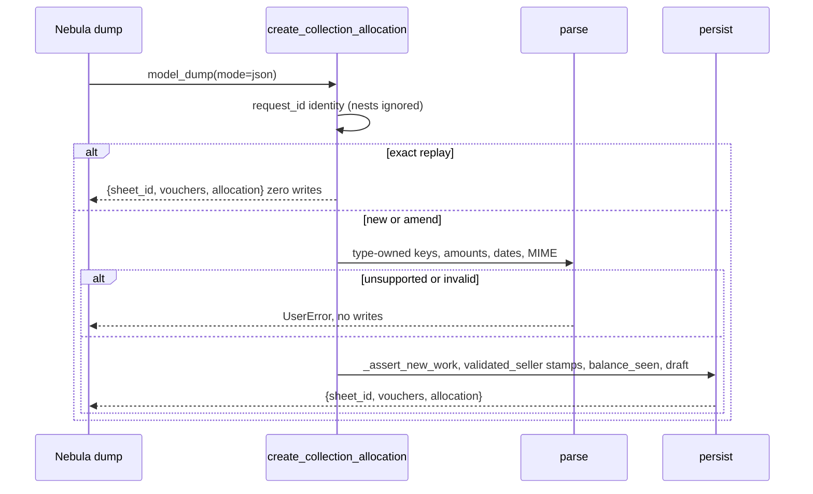

# Design: Align Allocation Contracts

## Technical Approach

One Python contract in `tools/collection_voucher.py` feeds flattened JSON Schema and the
parser so Nebula `CollectionAllocationRequest.model_dump(mode="json")` persists six
allocatable types. Catalog/Selection/`retention_kind` add three codes; `19.0.1.40.0`
unions allow-lists. Replay, draft, `balance_seen`, receipts, and
`{sheet_id, vouchers, allocation}` stay. MCP `unsupported` still raises with no writes.
No MuK, OWL, views, or reports.

## Architecture Decisions

| Option                                 | Tradeoff                                                                   | Decision                                                                                 |
| -------------------------------------- | -------------------------------------------------------------------------- | ---------------------------------------------------------------------------------------- |
| Runtime-strict flattened contract      | Discovery cannot encode per-type `oneOf`; mixed fields need runtime reject | **Choose** — MuK cannot keep `oneOf`; dump exactness is Python + goldens                 |
| Advertise Pydantic `oneOf` / patch MuK | Discovery would match dump                                                 | **Reject** — MuK edits forbidden; stripped `oneOf` is false security                     |
| Catalog-only, loose parser             | Smallest diff                                                              | **Reject** — `retention_kind` unknown; `image/jpg` MIME-fails; schema lies about strings |

## Data Flow

## File Changes

| File                                                 | Action | Description                                                      |
| ---------------------------------------------------- | ------ | ---------------------------------------------------------------- |
| `tools/collection_voucher.py`                        | Modify | Shared contract, seven-type schema, strict parse, MIME alias     |
| `tools/collection_allocation.py`                     | Modify | Receipt amounts `number\|string`; reuse normalizer               |
| `models/collection_voucher.py`                       | Modify | Seven-type Selection; `retention_kind` + ocr/seller copies       |
| `models/collection_voucher_review_snapshot.py`       | Modify | Same Selection + `retention_kind`                                |
| `models/res_company.py`                              | Modify | Expand `COLLECTION_TYPE_CODES`                                   |
| `data/collection_document_type_data.xml`             | Modify | XMLIDs `document_type_echeck`, `_cash`, `_retention_certificate` |
| `__manifest__.py`                                    | Modify | `19.0.1.40.0`                                                    |
| `migrations/19.0.1.40.0/post-migrate.py`             | Create | Union `_collection_enable_all_document_types()` on all companies |
| `tests/test_collection_mcp_allocation.py`            | Modify | Dump goldens; keep `unsupported` reject                          |
| `tests/test_collection_mcp_tool.py`                  | Modify | `image/jpg`, null omit, type-foreign keys, cash no proof         |
| `tests/test_collection_company_settings.py`          | Modify | Seven XMLIDs                                                     |
| `tests/test_collection_company_migration.py`         | Modify | `1.40.0`; migrate folder; union four-type company                |
| `AGENTS.md`                                          | Modify | Catalog 7; version/migrate notes                                 |
| `/home/crisd/projects/nebula/nebula-agent/AGENTS.md` | Modify | Delete catalog-blocker paragraph                                 |

No deletes. Views, OWL, PDF, XLSX, MuK, Nebula `schemas.py` unchanged.

## Interfaces / Contracts

Schema and parser share maps in `tools/collection_voucher.py`. Flattened schema lists
the union; runtime enforces the discriminator.

| `document_type`         | Persist      | Allowed nest fields (+ required `document_type`)                                               |
| ----------------------- | ------------ | ---------------------------------------------------------------------------------------------- |
| `bank_transfer`         | yes          | `amount`, `from_account`, `to_account`, `voucher_number`, `voucher_date`                       |
| `check` / `echeck`      | yes          | `amount`, `check_number`, `check_bank`, `check_issue_date`, `check_payment_date`, `check_type` |
| `cash_deposit`          | yes          | `amount`, `to_account`, `voucher_number`, `voucher_date`                                       |
| `retention_certificate` | yes          | `amount`, `voucher_number`, `voucher_date`, `retention_kind`                                   |
| `cash`                  | yes          | `amount`, `voucher_date`; `attachment`/`raw_ocr` null or omit                                  |
| `unsupported`           | catalog only | discriminator only; **write UserError, zero writes**                                           |

- Nest keys outside `_REVIEW_EDITABLE_FIELDS` or the type’s set → `UserError`. Null/`""`
  omit.
- `retention_kind`: `iva` \| `ganancias` \| `iibb` \| `suss` \| `other` (or omit).
- Amounts (nests + receipt `amount`/`balance_seen`/`amount_applied`): number or decimal
  string; reject non-finite/`NaN`/`Inf`/≤0; `float` then `currency.compare_amounts`.
  Schema `anyOf: number, string` (nullable on nests).
- Dates present must be `YYYY-MM-DD`. Check/echeck: both dates ⇒
  `check_payment_date >= check_issue_date`. Do not re-derive `check_type` (`common` \|
  `deferred` when set).
- MIME: strip params, casefold; alias `image/jpg` ↔ `image/jpeg`. Keep image/\* or
  `application/pdf`.
- XMLIDs: `collection.document_type_{echeck,cash,retention_certificate}`.
- Current, `ocr_*`, `seller_*`, snapshot share `_DOCUMENT_TYPE_SELECTION` (7) and
  `_RETENTION_KIND_SELECTION`. `_REVIEW_EDITABLE_FIELD_ORDER` gains `retention_kind`.

## Testing Strategy

Strict TDD: failing goldens **before** parser/catalog edits. Inline dicts matching
`model_dump(mode="json")` (`format(value, "f")`, ISO dates, explicit nulls). No
nebula-agent import. Float-safe integers (`"150000"`).

| Layer            | What to Test                                                                                                                                                                                  | Approach                                                   |
| ---------------- | --------------------------------------------------------------------------------------------------------------------------------------------------------------------------------------------- | ---------------------------------------------------------- |
| Unit (RED first) | Six dumps persist; `unsupported` no writes; cash no proof; `retention_kind`; string decimals; `image/jpg`; extra/type-foreign keys; catalog 7; migrate unions four-type company, keeps extras | `TransactionCase` in existing MCP/settings/migration files |
| Integration      | Replay, draft, `balance_seen`, receipts, response keys                                                                                                                                        | Existing allocation tests + goldens                        |
| E2E              | N/A                                                                                                                                                                                           | config e2e unavailable                                     |

## Threat Matrix

N/A — no routing, shell, subprocess, VCS/PR, executable-file, or process-integration
boundary. Parse/persist stays in-process on `muk_mcp.mixin`.

## Migration / Rollout

Upgrade loads three catalog XML rows, then `migrations/19.0.1.40.0/post-migrate.py`
calls `env["res.company"].search([])._collection_enable_all_document_types()`
(`Command.link`; extras kept). Do not use empty-only seed. `res.company.create` already
unions. Rollback: revert to `19.0.1.39.0` + Nebula `AGENTS.md`; new-type rows stay until
operators delete.

## Open Questions

- None. Specs may still be in progress; design matches proposal + exploration + live
  helpers.
